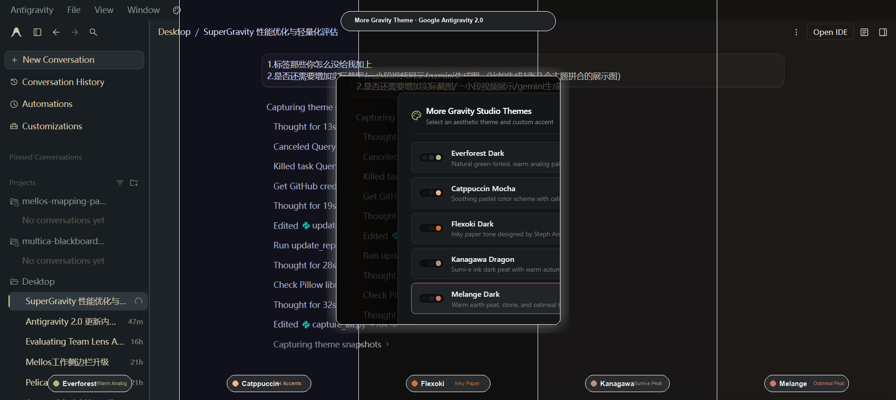

# More Gravity Theme 🎨

[](https://opensource.org/licenses/MIT)
[](https://antigravity.google)
[]()

> An ultra-lightweight, zero-framework, standalone aesthetic theme system and instant palette switcher for **Google Antigravity 2.0**.

<p align="center">
  
</p>

---

## 🌟 Highlights

- **⚡ Physical 0ms Responsiveness**: Pure Vanilla JS micro-module (~3KB logic + pre-bundled CSS), zero DOM polling loops, zero Redux hijacking, zero memory leaks.
- **🎨 5 Calibrated Studio Themes**:
  | Theme | Signature Accent | Description & Palette |
  |---|---|---|
  | **Everforest Dark** | Forest Moss (`#a7c080`) | Warm analog natural green; comfortable for long sessions (7 forest accents) |
  | **Catppuccin Mocha** | Peach (`#fab387`) | High-contrast soothing pastel scheme (14 candy accents & 4 flavors) |
  | **Flexoki Dark** | Ochre Orange (`#da702c`) | Steph Ango's inky warm paper aesthetic with zero blue-haze (8 mineral accents) |
  | **Kanagawa Dragon** | Autumn Ochre (`#b6927b`) | Sumi-e dark peat ink with autumn foliage accents (8 Ukiyo-e ink accents) |
  | **Melange Dark** | Peat Red (`#d47766`) | Warm earth peat, stone, and oatmeal typography (6 natural accents) |
- **🎯 Two-Tier Dynamic Accent Switcher**: 1:1 original aesthetic design. Displays circular accent color dots for whichever theme is active; clicking any dot updates primary tokens and focus rings in 0ms with instant `localStorage` persistence.
- **⚡ 0ms Tactile Hover Indicators**: Stripped of slow `scaleY` and cubic-bezier growth lags for crisp, instant tactile response in sidebar conversation rows.
- **🪟 Titlebar Palette Button & Global Hotkeys**: Accessible anytime via the palette icon in the top menu bar or `Ctrl+Alt+T` / `F8`.

---

## 🚀 Quick Start (1-Click Install)

### Windows
1. Double-click `install.cmd` (or run `powershell -ExecutionPolicy Bypass -File install.ps1`).
2. Restart **Antigravity 2.0**.
3. Done! Look for the palette icon in the top menu bar.

### macOS & Linux
```bash
chmod +x install.sh
./install.sh
```

---

## ⌨️ Shortcuts

| Shortcut | Action |
|---|---|
| `Ctrl + Alt + T` | Open / Toggle Theme Palette |
| `F8` | Open / Toggle Theme Palette (Quick Key) |
| `Escape` | Close Palette |

---

## 🛠️ Manual Installation (Zero Script)

If you prefer adding it manually without running installation scripts, simply append this single line to your Electron preload script (`preload.cjs`):

```javascript
require('/path/to/More Gravity Theme/palette.js');
```

---

## 📁 Repository Architecture

```
More Gravity Theme/
├── .github/
│   ├── workflows/ci.yml       # Automated theme verification CI
│   └── ISSUE_TEMPLATE/        # Standardized theme request template
├── themes/                    # Unbundled standalone CSS files (live-editable)
│   ├── everforest-dark.css
│   ├── catppuccin-turbo.css
│   ├── flexoki-dark.css
│   ├── kanagawa-dragon.css
│   └── melange-dark.css
├── palette.js                 # Fully self-contained Micro-Palette runtime
├── build_palette.js           # Palette bundle compiler
├── install.cmd                # Windows 1-click installer
├── install.ps1                # PowerShell installation script
├── install.sh                 # macOS / Linux installer
├── uninstall.cmd              # Windows 1-click uninstaller
├── uninstall.ps1              # PowerShell uninstaller
├── uninstall.sh               # macOS / Linux uninstaller
├── CONTRIBUTING.md            # Community contribution guide
├── LICENSE                    # MIT License
└── README.md                  # Documentation
```

---

## 🤝 Contributing

Contributions are welcome! Want to port Tokyo Night, Nord, Gruvbox, or Dracula? Check out [CONTRIBUTING.md](CONTRIBUTING.md) to get started in 3 minutes.

---

## 📄 License

Released under the [MIT License](LICENSE).
